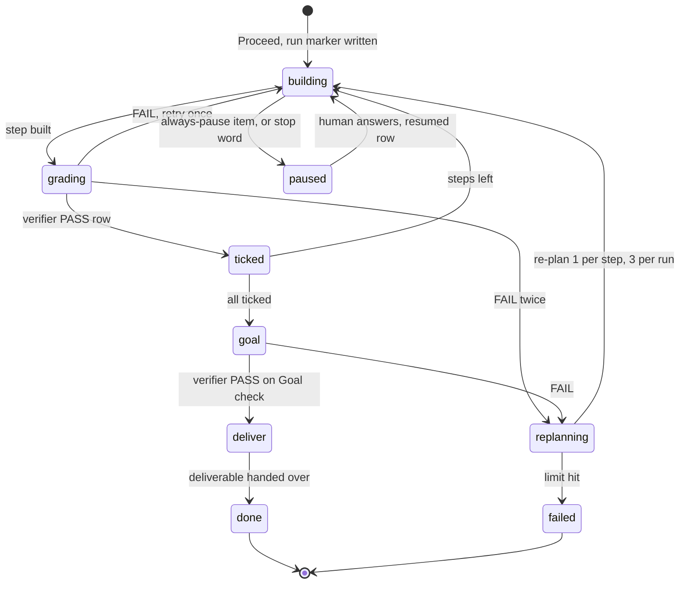

# mentor Plan

## Host portability

Use a structured question UI when the host offers one; otherwise ask the same focused question directly and wait for the answer. If delegated agents are unavailable or prohibited, perform the required research, review, or implementation serially and retain the same evidence, scope, and verification contract. Treat Mentor helpers as optional host integrations: resolve them with `PLUGIN_ROOT` first, then `CLAUDE_PLUGIN_ROOT`; if neither is available, work from the repository's durable `.mentor/` artifacts and report any state action that cannot be performed safely. This rule overrides later host-specific tool names, preserving user choice and plan continuity across hosts.

The flow: check the gate & load the constitution → clarify if needed →
pick a playbook & research → triage open questions (evidence, decision-maker,
human) → write the Markdown plan (Goal check, decision log, Constitution Check
when a constitution exists) → (optional review page via `mentor:previewing`, on
request) → **the one human approval** → run until the Goal check passes →
deliver with a Done review. This is the core concept pinned in the
marketplace's `AGENTS.md` → Mentor core concept.

While this worktree's `.planning.<wt-id>` marker is armed — or the legacy,
repo-global `.planning` marker, which blocks every worktree at once —
`plan-gate.sh` blocks every Write/Edit/MultiEdit/NotebookEdit inside the repo
working tree. The only files written during planning are the plan and its
opt-in review page (plus, when that page's first build asks about
diagram-design, the `diagram_renderer` key in `.mentor/config.json`), all
inside the gate-exempt `.mentor/` tree. Do not run
repo-mutating shell commands during planning either; Bash is not enforced,
but the rule is the same.

## Step 0 — Gate & constitution {#gate}

This is a direct planning entry point: select it when the user asks to plan, whether
they use natural language, a host's skill picker, or Claude Code's `/mentor:plan`
facade. **Do not make source edits while planning; write only the durable `.mentor/`
plan artifacts until the user explicitly approves.** The Claude facade adds an enforced
worktree gate; other hosts use this same boundary as an instruction. The boundary stays
explicit because an unavailable host integration must not turn a planning request into
unannounced implementation.

Resolve the optional Mentor helpers portably. `PLUGIN_ROOT` is the canonical host
contract; `CLAUDE_PLUGIN_ROOT` is a Claude Code compatibility fallback:

```bash
plugin_root="${PLUGIN_ROOT:-${CLAUDE_PLUGIN_ROOT}}"
if [ -n "$plugin_root" ] && [ -f "$plugin_root/hooks/plan-state.sh" ]; then
  mentor_dir="$(bash "$plugin_root/hooks/plan-state.sh" dir)"
  gate="$(bash "$plugin_root/hooks/plan-state.sh" gate)"
  printf 'MENTOR_HELPERS=available\nGATE=%s\n' "$gate"
else
  repo_root="$(git rev-parse --show-toplevel 2>/dev/null || pwd)"
  mentor_dir="$repo_root/.mentor"
  gate="ADVISORY"
  printf 'MENTOR_HELPERS=unavailable\nGATE=ADVISORY\n'
fi
```

When `GATE=ARMED`, preserve the existing Claude worktree gate behavior. `STALE`,
`RELEASED`, and `ARMED_ELSEWHERE` do not gate this worktree. When `GATE=ADVISORY` or
another non-armed value is returned, continue directly — never send the user away to a
slash command — and state that no host-level edit gate is active. Do not run
`begin-plan.sh` merely to simulate the command facade.

(Why a genuine Claude gate must be observed when present: `references/rationale.md`
→ **Step 0 — the armed-gate check**.)

When the Claude facade ran, `begin-plan.sh` may have printed a **`CONTEXT:`** line (the context gate):

- **`CONTEXT: WARN`** — the session is getting large. Surface it to the user. Nothing
  about *how* you plan changes.
- **`CONTEXT: HIGH`** — over the limit. Everything WARN does, plus: do not propose a
  review page (Step 5) yourself — an explicit user ask is still honored. "Keep the plan
  lean" means exactly that omission: Step 4's content spec never shrinks.

The context gate only warns.

**An already-approved plan goes straight to implementation.** When the facade printed
**`ALREADY APPROVED: <slug>`** (`begin-plan.sh` saw that slug `approved` or
`in_progress`, owned by this worktree or unowned, and did not arm) — or, on direct or
other-host entry, the user named an existing plan and its sidecar passes the same rule:

```bash
plans="$mentor_dir/plans"   # mentor_dir from the Step 0 block
jq -r '"stored=\(.state // "") owner=\(.owner // "") note=\(.note // "")"' "$plans/<slug>/.state.json"
```

Build when `stored` is `in_progress`, whatever the step ticks say — an all-ticked run
still owes After Proceed step 6 onward. Build when `stored` is `approved` only if the
ticks have not taken it past that (with helpers, `plan-state.sh query --slug <slug>
--format tsv --fields state` reads `approved` or `in_progress`). This is the rule
`begin-plan.sh` applies. If `owner` is set and differs from this worktree, and this is
not the facade path, ask the user before building.

Then load the constitution (below in this step) and every playbook the plan's
`## Playbook` line names, skip Steps 1–6, and go to **After Proceed — run until the
Goal check passes** (`{#implement}`) for that slug — re-planning an approved plan would
only re-ask a question the user already answered. Two checks first: a `note` saying it
was **not individually reviewed** (a plan swept in by a release) means nobody approved
it on its own — confirm with the user before building it; a `note` starting `paused:`
means the run stopped on that decision-log row — ask its question first, write the
`resumed` row, then continue. A resumed run has no run marker (only `approve-plan.sh`
writes one, for the session that approved), so the Stop hook does not hold this
session: keep working until a terminal state per **Hosts without a Stop hook or
subagents**. To re-plan instead, run `plan-state.sh set <slug> draft`, then plan it
again (`/mentor:plan <slug>` in Claude Code).

**Load the constitution.** Resolve the constitution path (a repo may keep its
governing doc outside `.mentor/` — `constitution_path` in `.mentor/config.json`
points at it; see `/mentor:constitution`'s adopt-by-reference branch):

```bash
# `mentor_dir` comes from the Step 0 helper-or-artifact fallback. Re-derive it when
# this runs in a separate shell.
plugin_root="${PLUGIN_ROOT:-${CLAUDE_PLUGIN_ROOT}}"
if [ -n "$plugin_root" ] && [ -f "$plugin_root/hooks/plan-state.sh" ]; then
  mentor_dir="$(bash "$plugin_root/hooks/plan-state.sh" dir)"
else
  mentor_dir="$(git rev-parse --show-toplevel 2>/dev/null || pwd)/.mentor"
fi
repo_root="${mentor_dir%/.mentor}"
const_rel="$(jq -r '.constitution_path // empty' "$mentor_dir/config.json" 2>/dev/null)"
const_path="${repo_root}/${const_rel:-.mentor/constitution.md}"
```

If the resolved file exists, `Read` it now — its principles are governing rules
for this repo. Keep them in mind through research and design, and prove
compliance in the plan's **Constitution Check** section (Step 4). If it is
absent but `docs/constitution.md` or `CONSTITUTION.md` exists at the repo root,
surface that once: the repo appears to have a governing doc mentor is not
reading — suggest `/mentor:constitution` to adopt it by reference. Otherwise no
constitution governs this repo; skip the Constitution Check (you may mention
`/mentor:constitution` once if the user seems to want project-wide rules).

## Step 1 — Clarify (optional) {#clarify}

If the request is ambiguous — unclear scope, multiple plausible interpretations,
missing acceptance criteria — invoke `Skill(skill="mentor:grilling")` before
designing anything. Skip this for well-specified tasks.

## Step 2 — Research {#research}

**Pick a playbook first.** A playbook is a skill named `playbook-<name>` whose
description states the goal shapes it fits (`playbook-software-change` fits
"change code in a repo"). Match the goal against the descriptions of the
playbooks available this session — the session's skill list, not a filesystem
hunt — and load each that fits. A loaded playbook supplies five overlays the
general flow reads at the points named in brackets:

| Overlay | Read at |
|---|---|
| Research directives | this step |
| Definition of done | Step 4 `## Goal check` and each `Done when:` |
| Extra always-pause items | the run (After Proceed), on top of the constitution's |
| Deliver mode | the run's deliver state |
| Evidence kinds | the Done review |

Record the pick as a `## Playbook` line in the plan and a decision-log row. No
match → the general flow runs alone (`## Playbook` reads `none`). Several may
match: their overlays combine and their always-pause items are a union. The user
can name or refuse a playbook in plain words; that wins over the match.

Research what the plan needs: the files, config, docs and history the work touches,
and the facts each decision will turn on. How you gather it is up to you and the host —
read directly for a small task, or use whatever research tooling the host offers for a
wide one. Bring back conclusions with `file:line` evidence and a short list of open
questions; those questions feed Step 3's triage and are never silently dropped. When the
plan touches a second repository, resolve its real path first — the edit gate protects
only the repo the session's CWD sits in.

**Research the category, not just the named instance.** When the request names
one instance of something the repo may have several of — one job to make
continuous, one config to centralize, one surface to consolidate — search for
its siblings before drafting, and carry each hit into Step 3 as a scope
decision. A sibling found at the approval gate rewrites the plan; the same
sibling found here costs one question.

**When the request corrects a bad state, also find what regenerates it.** A
migration or cleanup that only fixes the data leaves whatever produced it free
to reproduce the same defect on the next run — a script, an importer, a cron
job, a form handler, or a skill/rule that doesn't validate before writing are
all candidates. Search for that producer before drafting, and carry what you
find into Step 3 as a scope decision, the same way a sibling instance is
above.

**A page/feature joining an existing repeated pattern may have its membership
tracked in more than one place.** Wiring a new entry into a nav list, a
routing table, a tab registry, or any other structure that already has
several siblings sometimes means updating a second, independently-maintained
list that mirrors the first without either side pointing at the other — a
route table beside a nav list, a hardcoded switch beside a registry. Check
for a second list before drafting, the same way a sibling instance is above;
a hand-paired list found at the approval gate rewrites the plan, the same
list found here costs one question.

**A same-session restart — or an earlier grill — is not a blank page.** When
the user interrupts mid-research to broaden or redirect the request and
re-invokes `/mentor:plan`, or when a `grilling` phase (via `/mentor:grill`
directly, or Step 1's own route into it) already ran earlier in this session,
check the conversation for research findings already delivered on the same
subject before starting a fresh round — a broadened scope usually extends
prior findings rather than replacing them, and a prior grill's research
may have already covered the same ground, so re-researching territory
already covered wastes a full round on overlap the transcript already has
the answer to. Research only the ground the broadened request — or the
grill's own research — genuinely didn't cover.

**Never search `.mentor/` with a recursive `grep` — use `sweep`.** Ignore rules make a
recursive grep report a clean zero for a recorded instruction, which looks the same as
"nothing recorded" (mechanism: `references/rationale.md` → **Step 2 — why searching
`.mentor/` needs `sweep`, not a grep**). `sweep` hands grep an explicit file list and
resolves linked worktrees to the main repo's `.mentor/`:
```bash
[ -d "${PLUGIN_ROOT:-${CLAUDE_PLUGIN_ROOT}}/hooks" ] || { echo "ERROR: Mentor helper unavailable — set PLUGIN_ROOT (or use the Claude compatibility fallback) or use the documented artifact fallback" >&2; exit 1; }
bash "${PLUGIN_ROOT:-${CLAUDE_PLUGIN_ROOT}}/hooks/plan-state.sh" sweep "<pattern>" --roots plans
```
It prints `SWEEP: roots=N files=N hits=N` before any hits, so a zero is trustworthy only
when `files=` is non-zero; exit **2** plus a `NOTHING-SEARCHED` line means it read nothing
at all and its silence is not evidence.

**Verify literal CLI commands, and claims about a live system's current state, before
drafting them into the plan.** A deploy/release-shaped step that types an exact command
from memory or a runbook paraphrase otherwise gets its first real syntax check when it
runs verbatim against a live system. Before
writing a literal command into such a step, verify it (`--help`, `--dry-run`, or the
tool's own docs) rather than transcribing it as fact. The same applies to claims about
the deploy target's current state (backups exist, a version is what you think it is,
a rollback path works): verify it this session, or write it as conditional on a named,
mandatory verification command, with the fact stated as unverified rather than asserted —
an external-state claim nobody re-checked reads as fact to whoever runs the step. A step
with no captured pre-change state has no rollback anchor either way.

**A fast-moving vendor/product/SDK topic goes to the reference skill before it goes to
memory.** When a research topic names an external platform, SDK, or cloud service that a
skill already available this session covers — the session's skill list, not a filesystem
hunt — load that skill before answering, and make sure any research you hand off is
told to load it too; recall from training data is where such topics go stale first.
Whenever the name could mean more than one product or API from the same vendor, say in
the findings which one they describe — a silent pick surfaces only downstream, after it
has already shaped a user question.

## Step 3 — Triage open questions & decisions {#decisions}

Before writing the plan, drain every open question so the plan encodes
decisions, not question marks. Collect them from all sources: the open
questions research surfaced (Step 2), the playbook's directives, and any design
fork you noticed yourself (approach A vs B, scope boundary, acceptance criteria,
naming). The human is asked only what no one else can answer (AGENTS.md →
Mentor core concept, rule 4).

Triage each item into exactly one bucket, in this order:

1. **Codebase-answerable** — the files, config, history, or docs settle it.
   Answer it yourself; never ask the human what the material can answer.
2. **Experiment-settleable** — a fact a quick probe can establish (does this
   flag exist, which form does the tool accept, how long does it take). Run the
   probe in a private `mktemp -d` scratch dir, or under
   `.mentor/plans/<slug>/evidence/` when the result is worth keeping as
   evidence. Record the probe and its output as a decision-log row.
3. **Constitution-covered** — a reversible call that the constitution's
   Decision authority (or, with none, ordinary good practice) lets an agent
   make. Dispatch a decision-maker (below) and log its choice.
4. **Product call** — preference, product direction, a trade-off with no
   objectively right answer that the Decision authority does not cover, or any
   choice that commits an always-pause item. Queue it for the human (before approval
   only; mid-run see After Proceed, steps 4–5).

**Immaterial** items — the plan comes out the same either way — are dropped, or
logged as a flagged assumption.

### Decision-maker dispatch {#decision-maker}

- **Brief** (self-contained; the agent inherits none of your context): the
  question in plain words, the options known so far with their consequences, the
  constitution's Decision authority section verbatim, and the evidence with
  `file:line` or command output.
- **Routing**, using the first agent present in the host's agent list:
  `system-decision-maker` for architecture, backend, data, infra, or rollout;
  `ux-decision-maker` for anything a person sees or does; `general-decision-maker`
  for everything else. When none exists, dispatch a general-purpose subagent with
  the same brief and the instruction "decide; do not ask".
- **Return**: `choice · why · evidence · product_call: yes|no`. A `yes` sends the
  item to bucket 4. Several independent items may go out in one batch.
- Every decision becomes one decision-log row (Step 4), `result: decided`.

**Mid-loop scope change.** A scope-change request (not a decision *answer* —
a change to what the plan covers) pauses the per-item loop: confirm the scope
delta itself — what's kept, what's cut — in one `AskUserQuestion` before
continuing. A derived boundary question asked in its place resolves nothing,
because the boundary it assumes was never agreed.

Resolve the queued product calls via `AskUserQuestion`, ordered by dependency:
resolve the decision other decisions hang off first, and let each answer narrow the
next question.

**How many decisions ride in one call is a judgment call with two hard edges.** The
reason to separate them is that a decision answered while three others compete for the
same attention gets a rushed answer; the reason to combine them is that a plan with six
independent decisions should not cost six round trips. So:

- **A decision gets its own call when it is consequential** — it changes what gets
  built, what it costs, or what has to be redone if the answer turns out wrong. The
  clearest tell is that the options diverge sharply: one is an afternoon and another
  is a week, or one forecloses something the other keeps open. These deserve the
  user's whole attention, and a wrong answer here is expensive to unwind.
- **A decision must stay sequential when an earlier answer could change it** — its
  options, its framing, or whether it needs asking at all. This is not a preference;
  a question whose premise the previous answer just invalidated is worse than no
  question, and the dependency ordering above is what surfaces these.
- **Everything else may ride together**, up to the tool's cap of four questions per
  call. Each is still a separate question the user answers on its own screen with its
  own decision brief — combining calls saves round trips, never deliberation. Group
  only decisions that genuinely cannot affect each other; when in doubt whether two
  interact, they are sequential.

Never offer bulk acceptance as an *option* on a question: these decisions share no
common binary (accept/reject) to apply in bulk, so a bulk button here would be
ill-defined.

**Free-typed bulk-accept.** If the user free-types an instruction to take your
recommendations rather than answering item by item — often by interrupting the open
question ("go with your recommendation", "pick the defaults") — map it onto the queue:
accept the recommended option for every decision still unanswered; every question here
carries one by construction (below), so this path leaves nothing unresolved. Before
drafting, name what you are accepting on — each decision by its plain-language name,
one line each — since "your recommendation" after four answered questions usually
means the remainder but can mean the whole set, and the user can only correct a span
you showed them. An instruction that also changes what the plan covers is a scope
change first: resolve it under the rule above, then resume. Naming the span is what
makes this safe even when several decisions rode in one call — the user sees exactly
which recommendations they just accepted.

**Every question ships with decision support, and stands on its own** — the
user answers from the question screen alone, never sent to a file, a plan
section, a coined id or code (`G14`, `P2`), or an earlier turn to learn what
the question means. A word the user could read as themselves — "user" above
all — never names a domain entity; when a reviewer finding or a research
return used it that way (a caller, a row, a consumer), rename it before the
question reaches the screen. Name things in plain language, quote the
evidence that decides it rather than citing where it lives, and say in each
option what it changes and what it costs:

- In the message text **before** the tool call, give a compact decision brief:
  what the decision is, why it matters to this plan, and the relevant evidence
  from research (observed behavior, constraints, and the code itself — quote
  the line that decides it and put its `file:line` beside the quote, so the
  address is a courtesy for the curious rather than homework for the answer).
  When the decision turns on what is actually in a data or config artifact,
  read the artifact — a research summary's or the plan's own description of
  it is not the evidence. Enumerate the rows a rule applies to, not just the
  rule.
- `AskUserQuestion` needs 2–4 options per question. For open-ended decisions
  (naming, free-form scope), synthesize 2–4 concrete candidates from the
  research — the tool adds a free-text "Other" automatically, so a candidate
  list never traps the user. Only when you truly cannot form two sensible
  candidates, ask in plain prose instead.
- Put your **recommended option first** with "(Recommended)" appended to its
  label (a convention for decision questions like these — fixed workflow gates
  such as Step 6's approval order by position alone), and make each option's
  `description` carry its concrete consequence or trade-off — not a
  restatement of the label. The recommendation itself must be the most
  practical and clean solution — never trade maintainability or reliability
  for implementation speed.
- When options are competing shapes (schemas, layouts, flows, wording), use
  the `preview` field so the user compares them side by side — but keep it to
  a short literal fragment of the thing being chosen between (the actual
  snippet, schema, or wording; roughly ≤10 lines), never a framed mockup.
  Box-drawing glyphs and non-ASCII text (Thai, CJK, …) each expand to a
  6-byte `\uXXXX` escape inside the tool call's JSON, so a mockup that looks
  small on screen can truncate the call mid-string and fail validation —
  costing a whole turn to retry. **If the comparison needs a frame, a grid,
  or aligned columns to be legible, it is not a `preview`**: say so in the
  decision brief and offer a review page (Step 5 / `mentor:previewing`) instead —
  the user asking is the opt-in that step requires.

Each answer becomes a plan input and a decision-log row (`result: kept`). An
"Other" answer may open new questions — triage those through the same buckets. If the user explicitly defers a
decision, record the deferral in the plan (as a flagged assumption or under
Out of scope) rather than silently choosing for them. A rejected or
interrupted question is neither an answer nor a deferral — when the
clarification lands, re-issue the question; a recommendation given in prose
does not resolve a decision, and an unresolved decision that is never
re-asked is the shape a stalled plan takes.

**Skip condition:** no product calls survived triage → proceed straight to
Step 4. Never manufacture questions to fill the step — a well-specified task
with clean research needs zero.

This step resolves *post-research* decisions with evidence in hand; Step 1's
grilling handles *pre-research* ambiguity in the request itself. An earlier
grill session does not skip this step — research may have surfaced new forks —
but a decision already resolved anywhere in the conversation is never
re-asked.

## Step 4 — Write the Markdown plan {#write-the-plan}

**Check for a topic-adjacent existing plan before minting a slug** — a re-typed
request derives a fresh slug with no memory of an earlier attempt on the same
topic, and `ensure-dir` below will happily create a second directory beside it,
orphaning whichever one doesn't get worked on next:

```bash
plugin_root="${PLUGIN_ROOT:-${CLAUDE_PLUGIN_ROOT}}"
if [ -n "$plugin_root" ] && [ -f "$plugin_root/hooks/plan-state.sh" ]; then
  bash "$plugin_root/hooks/plan-state.sh" list --owners
else
  repo_root="$(git rev-parse --show-toplevel 2>/dev/null || pwd)"
  find "$repo_root/.mentor/plans" -mindepth 2 -maxdepth 2 -name plan.md -print 2>/dev/null
fi
```

This is a quick scan, not a fuzzy-match algorithm: only act on a genuinely obvious
naming match — when in doubt, mint fresh, since a false reuse is worse than an
extra plan dir. If one plainly names the same topic, reuse that slug for
`plan_dir` below instead of minting a new one, and read its sidecar `note` for any
prior decision or rejection worth carrying forward — through the helper's plans dir,
never a CWD-relative path (a session in a subdirectory or linked worktree would read
nothing):

```bash
jq -r .note "$(bash "${PLUGIN_ROOT:-${CLAUDE_PLUGIN_ROOT}}/hooks/plan-state.sh" dir --plans)/<slug>/.state.json"
```

(Without the helper, read `$repo_root/.mentor/plans/<slug>/.state.json` from the scan
above.) **Never reuse a slug the OWNER
column shows as owned by a different worktree** — that is another worktree's live
or recent draft, not yours to continue; mint a fresh slug instead, the same call
you'd make if nothing plainly matched. Reuse is safe only for a slug this
worktree already owns, or one the OWNER column shows unowned (`-`).

Then mint the plan directory and, when the bundled helper is available, its state
record in **one** call (substituting a kebab-case `<slug>` derived from the request —
≤30 chars, drop articles, keep nouns/verbs):

```bash
plugin_root="${PLUGIN_ROOT:-${CLAUDE_PLUGIN_ROOT}}"
if [ -n "$plugin_root" ] && [ -f "$plugin_root/hooks/plan-state.sh" ]; then
  plan_md="$(bash "$plugin_root/hooks/plan-state.sh" start "<slug>")" || exit 1
else
  repo_root="$(git rev-parse --show-toplevel 2>/dev/null || pwd)"
  plan_md="$repo_root/.mentor/plans/<slug>/plan.md"
  mkdir -p "$(dirname "$plan_md")"
fi
echo "$plan_md"   # fixed name inside the slug dir, NO timestamp — stable across revisions
```

When available, `start` does two things in one call: creates the dir and locks the
whole path to 700, and records the plan as `draft` in a hidden `.state.json` beside
it. Its stdout is exactly the plan path, so the capture above fails the
pipeline if anything went wrong; the state summary goes to stderr where you can still
read it.

With no helper, write the same `plan.md` at the printed path and do not invent or
overwrite a `.state.json` sidecar: an existing state file remains compatible with the
Claude facade, while a host adapter can add equivalent lifecycle updates later. The
plan itself stays the portable source of truth.

Two helper-backed consequences worth knowing:

- **Ownership is stamped on this call** — `start` marks THIS worktree as the dir's owner,
  and last-write-wins, so running it on a slug another worktree minted re-owns it to you.
  That is how a plan continues in a different worktree.
- **It is idempotent** — re-running it on a revision is harmless, so there is no branch
  to pick between "new plan" and "existing plan".

Write the plan at that path with the `Write` tool. Approval and later sessions read
the state record to know which plans are built and which are pending.

The path is inside the gate-exempt
`.mentor/` tree, so the edit gate allows it; `plan-open.sh` auto-opens it for review the first time
(VSCode tab when available; opener configurable through the host's Mentor environment).
Opening is a convenience, not a delivery requirement. **Keep it current:** on every revision
re-write this SAME file in place — never create a second timestamped copy. Never write the plan
to a host-native plans directory instead of `.mentor/`.

**Verify the write:** when a revision applies a sequence of `Edit`s rather
than one whole-block rewrite, re-`grep -n` each edit's target text against
the file's current on-disk state immediately before applying it — an earlier
edit in the same pass can shift nearby text out from under a stale anchor,
and a miss usually means it already moved. An `Edit` whose anchor lands
mid-table or mid-fence can also splice a row or split a fenced block without
erroring — nothing else in this skill catches it, and a revision built from
many small edits (a decision resolution, a split, a scope trim) is exactly
when this happens. After such a revision, run:

```bash
bash "${PLUGIN_ROOT:-${CLAUDE_PLUGIN_ROOT}}/hooks/plan-state.sh" verify <slug>
```

when the helper is available. Otherwise perform the equivalent visible checks — balanced
fences, valid tables, and a `Done when:` for every implementation step — before asking
for approval; do not fail a portable planning flow solely because the helper is absent.

`verify` is one call for the four checks that gate its exit code: fence balance,
table pipe-count uniformity, every step in `## Implementation steps` carrying a
`Done when:`, and a new plan carrying `## Goal check` and `## Decision log` (why one call: `references/rationale.md` → **Step 4 — why verify is one
call**). A non-zero exit
names the failing check on its own `CHECK:` line — read that line rather than
guessing which one broke, since a step missing its `Done when:` is also what a
body truncated by a mis-parsed step line looks like. Every other `CHECK:` line
it prints is informational and never fails the call, `CHECK: context` included;
that one is the same reading "Re-check context" below asks for, so if nothing
else ran between this call and the approval ask, that reading already
satisfies it — no second `context` call needed. Prefer replacing a whole
table/fenced block in one edit over splicing a single row into it.

### Content spec

The `.md` file is the canonical plan — self-contained, portable, renders richly
on GitHub/GitLab and any Mermaid-capable viewer. No inline HTML/CSS/SVG.

Required sections, in order:

1. `# <Plan title>`
2. `## Context` — the problem, what prompted it, intended outcome.
3. `## Use case scenarios` — actors & triggers; current vs expected behavior;
   numbered concrete scenario walkthroughs (real values from research, not
   placeholders); edge cases & assumptions (flag anything unverified). Give this
   section visualization treatment — a Mermaid flowchart/sequenceDiagram of
   actor→trigger→outcome, or a current-vs-expected GFM table — so the reviewer
   can verify your understanding at a glance.
4. `## Approach` — the recommended design — the most practical and clean
   solution for the requirement, never trading maintainability or reliability
   for implementation speed — with one visualization per significant
   change/decision realized inline under its owning topic.
5. `## Constitution Check` — **include only when the constitution resolved in
   Step 0 exists** (default `.mentor/constitution.md`, or the file
   `constitution_path` points at). A GFM table with one row per principle: `Principle | Verdict | Notes`,
   verdict = ✅ complies / ⚠️ deviates / ➖ N/A. For every ⚠️, the Notes cell must
   either point at the plan change that resolves it or record an explicit,
   justified deviation. If a principle can only be honored by amending the
   constitution, say so and stop short of encoding the violation as the plan.
   A ✅/➖ verdict that rests on a repo search finding nothing names the
   gitignore-bypassed command it ran (Step 2's caveat) — a verdict resting on an
   unqualified `grep -r` is not yet earned.
6. `## Implementation steps` — numbered and concrete. Every step carries `Goal:`,
   `Inputs:` and `Done when:` on `-` bullets under its numbered heading; `verify` fails
   a step with no `Done when:` under it.
   **Keep it small while you write:** if the step count creeps past ~12, move non-core
   **isolated deliverables** into `## Out of scope` (each can become its own plan later).
   A plan's `## Verification` section is never one of those chunks — every topic stays
   with the work it checks.
   **Never title a step "Verification pass," "Testing," or similar** — that name
   belongs to the plan's own `## Verification` section below, and a step that reads
   as satisfying it invites skipping that section's checks at execution time. Name the step for what it builds or fixes instead.
   **A literal command written into a step here, on a live or shared system, must already
   be verified** per Step 2's directive — not transcribed from memory as you draft.
   **A check command must fail loudly.** Prefer a command's own exit status over a
   `|| echo 0` fallback — a real tool failure and a genuine zero then print the same
   output, and the fallback launders an error into a passing `Done when:`. A playbook
   may add its own command rules (the software playbook's pathspec rule, say).
7. `## Critical files` — cite a file this repo's own tooling edits
   automatically by **section heading**, never a line number: a stale line
   reads as confirmed instead of wrong. This applies anywhere in the plan
   that cites such a file, not just here — `## Implementation steps` and
   `## Verification` included.
8. `## Out of scope` — name every carve-out so the reviewer sees the
   boundary, but give one a **plan number or slug** only when it resolves on
   disk (an existing plan under `.mentor/plans/`);
   an invented `feature 0NN` reads as a roadmap promise nothing on disk backs.
9. `## Verification` — 2–6 single-focus topics, each in this shape:

   ```
   Topic N — <short title>
     Focus: <the single question this topic answers>
     Checks: <concrete commands to run / evidence to gather>
     Pass when: <observable criteria>
   ```

   Each topic runs after implementation, before the plan is marked `implemented`.
   `Topic N —`, never `Step N —` or a bare numbered item, keeps mentor's step
   counter from mistaking a verification topic for an implementation step. One
   focus per topic, because a gap in one check hides behind a pass in another.

   **This section owns end-to-end proof.** When a behavior can only be shown by
   exercising the whole deliverable (a running system, the full report read
   cold), write that check as a topic here, not into a step's `Done when:` — keep
   each `Done when:` to a bounded check, so a step can be ticked the moment its own
   change is proven.
10. `## Playbook` — one line: the playbook skill(s) picked in Step 2, or `none`.
11. `## Goal check` — the plan's done predicate: one runnable or observable check
    against the real deliverable, falsifiable, never a restatement of the steps
    ("`scripts/check` exits 0", "the brief covers all 5 regions, each with a cited
    source"). Shape it from the constitution's Definition of done and the
    playbook's overlay. The run is done only when a verifier grades it PASS.
12. `## Decision log` — one flat table, appended to for the life of the plan:

    ```
    | # | use case | decision | why | evidence | result | review? |
    ```

    `use case` names the `## Use case scenarios` entry the row serves (or `general`).
    `result` is one of `kept` (human answered) · `decided` (agent decided) · `PASS` ·
    `FAIL` (a verifier grade) · `paused` · `resumed` · `failed`. `review?` is `needed`
    for a paused row, a deviation from the plan, a mid-run product call decided by an
    agent, or a re-plan — `optional` otherwise. Every Step 3 resolution writes a row at
    drafting
    time; the run appends the rest. The flat table is canonical: grouping by use
    case happens only when it is rendered for review (After Proceed → Done review).

**Visualization decision rule (pick exactly ONE idiom per artifact):**

- Tabular data (field lists, diffs, matrices, before/after values) → **GFM table**.
- Topology / sequence / state (flows, state machines, ER, dependencies) →
  **Mermaid** fenced block.
- Spatial/layout fidelity (UI zone wireframes, fixed-width alignment) →
  **ASCII diagram in a code fence**.
- Callouts / cautions → **GFM alert** (`> [!NOTE]`, `> [!WARNING]`, …).
- Literal code / payloads → fenced code with a language tag.

**State vocabulary rule.** When a plan introduces, renames, or re-scopes a named
status for any entity (`MONITORING → PENDING`, `ACTIVE → TRIGGERED/CANCELLED`),
or changes which transitions are legal between statuses that already exist —
a new cascade side-effect where reaching one terminal status now forces
another, say — render the *transitions*, not just the values. A status name
staying put says nothing about its edges staying put. The `stateDiagram-v2`
the idiom rule already selects shows the shape — which states reach which,
added and removed edges marked; a companion
`From · Event/verb · To · Trigger · Cascade` table carries what a shape
cannot encode, and it is the table that exposes a
**missing** edge, since reverse transitions and cascade side-effects are the
ones that surface late. That pairing is complementary, not the same-thing-twice
the rule below forbids. Skip it when no entity has more than one named state, or
when the states are unchanged and only their storage moves — that delta belongs
in the plan's schema or per-column change table, and restating it here would
duplicate.

**Workspace layout rule.** When a plan introduces on-disk structure the reader cannot see
today — a new state/workspace directory, a sidecar or companion file, a naming scheme other
paths are derived from — render the layout as an **ASCII tree in a code fence** (the idiom
rule's spatial row), with a one-line note per new path saying what writes it. Prose naming
three paths reads as complete until someone has to create them in the right order; the tree
is what makes a missing one visible. Skip it when the change only touches paths that already
exist.

**Anti-duplication:** never restate in prose what a diagram already shows, and
never show the same thing two ways. Prose next to a diagram is limited to a
one-line caption, a legend, and the why/insight the diagram cannot encode.

**Mermaid portability rules:** do NOT set `theme`/`themeVariables`/`%%{init}%%`
(GitHub/GitLab apply their own); do NOT use `C4Context`/`C4Container` (use
`flowchart TB` + `subgraph` + `classDef` instead); keep each diagram small —
split dense flows into 2–3 focused diagrams; a `;` inside `Note over …: text`
truncates the note — use `,` or `+`.

**Generalist-reviewer principle:** write for a generalist, not a domain expert —
define jargon at first use, state why each step matters, prefer concrete
examples. The plan must be approvable by someone outside the domain.

**Verify headline counts before the first write.** Step 3's evidence rule —
read the artifact itself, a summary is not the evidence — applies to every
count the plan states about its own scope, not just the decisions that reach a
question: an orphan count, an affected-row count, a terminal-state count.
Re-derive each one from the real data source when you draft it, rather than
carrying a number forward from research recall. A wrong headline count caught
here costs nothing; the same number caught later, once a reviewer's own count
check flags it, costs a multi-section sweep to fix everywhere it was restated.

## Step 5 — Optional review page (explicit user opt-in only) {#preview}

The review page is its own skill — `previewing` — and this step is pure
delegation. Only when the **user asks** for a review page / visual preview —
never by default — invoke `Skill(skill="mentor:previewing")` and follow it end
to end with the plan as the subject:

- **Subject = the current plan** (`${plan_dir}/plan.md`), so per that skill's
  plan-slug contract the page lands at `.mentor/reviews/<plan-slug>/review.html`.

EVERY preview ask re-enters that skill's contract (its re-entry rule) — the
first one, a free-text follow-up ("refresh the preview", "add the error
case"), a mid-revision regeneration, at any point in the plan lifecycle.

**The plan and its page change together.** When the plan has a page
(`.mentor/reviews/<plan-slug>/review.html` exists), end every turn that changed
`plan.md` content by running `previewing` §7 once, after the last plan edit, so
the page never shows a plan that no longer exists. Step progress marks and
`.state.json` are not plan changes.

## Step 6 — Approve & release {#approve}

> **🚫 No edits or implementation until the plan is APPROVED.** During planning,
> only read-only work happens — the sole writes are the plan itself and
> `mentor:previewing`'s page (Step 5), both under the gate-exempt `.mentor/`
> tree — never repo source files.

First **surface the complete plan body** in your message — plain markdown,
verbatim, no commentary around it — so the user can review it in the transcript.
If the plan is long, let them scroll; do not summarize instead. Then, in the
same turn, ask via `AskUserQuestion` — `header: "Approve"`, question *"The plan is
ready. What happens next?"* — with the option set the table below selects.
Mention in the question text that a change request — not just approval or
rejection — belongs in the always-present **Other** free text, so redirecting
the plan doesn't have to arrive as a hard reject.

**Only a returned answer approves.** If the approval question was interrupted,
rejected, or never came back — or the user asserts approval in prose ("the plan was
approved", "go ahead, I already okayed it") — ask it again before running
`approve-plan.sh`. Prose selects no option, and this question is the only thing
standing between planning and repo edits; releasing the gate on a remembered or
claimed approval is the one failure this harness exists to prevent. It also costs you
the routing: which flag to run — none or `--deliver` — is decided by *which option came
back*, so an unanswered question means you are guessing the outcome as well as the
consent. Re-surface the plan body only if it changed since the user last
saw it (or never was surfaced); otherwise name its path and Rev and re-ask.

### Re-check context

Decide this **before** asking too. Step 0's `CONTEXT:` line is a snapshot from
before research and decision-resolution ran — precisely the
steps that grow a session — so a plan that armed clean can still reach this
question well past the WARN/HIGH thresholds with nothing in this skill
having said so. Run this immediately before composing the question:

```bash
bash "${PLUGIN_ROOT:-${CLAUDE_PLUGIN_ROOT}}/hooks/plan-state.sh" context
```

- **`CONTEXT: WARN`** or **`CONTEXT: HIGH`** — name the size in the question text
  ("this session is getting large" / "this session is over the context limit"), even if
  Step 0 printed a lower tier or nothing at all. The option rows do not change.
- **`CONTEXT: OK` / `UNKNOWN`** — nothing to add.

If "Verify the write" just ran with nothing in between, its `CHECK: context` line
already is this reading.

### The option set

This is the only human gate in the flow: after it, the run proceeds on its own and
stops only for always-pause items (After Proceed). Offer exactly these three options,
in this order, with these descriptions — and keep this table in this one file only; a
copy in a script drifts. (Why one gate and three options: `references/rationale.md` →
**Step 6 — why there is one gate and three options**.)

| Label | Description |
|---|---|
| Proceed | Validate the plan, release the edit gate, and run it until the Goal check passes. Stops only for always-pause items; every decision is logged for review. |
| Deliver plan only | Validate the plan and release the gate; the plan file is the deliverable — no implementation in this session. |
| Keep planning | Do not release — keep refining, or say what to change. Re-write the plan file and ask again when ready. |

Everything else the user may want reaches you through the always-present "Other" free
text: a change request, moving isolated deliverables into `## Out of scope`, or a
plan-quality ask — route it per **A plan-quality ask in "Other"** below. An "Other"
answer that plainly says to run the plan is a returned answer: treat it as **Proceed**.
Prose outside this question still approves nothing (above).
Name these in the question text so the user knows they need no button.

On a host without `approve-plan.sh`, use the user's returned choice as the same explicit
consent boundary, keep the plan at its durable `.mentor/` path, and report that no
host-level gate or lifecycle sidecar was changed. Do not claim an enforced release that
did not occur.

On **Proceed**, run:

```bash
bash "${PLUGIN_ROOT:-${CLAUDE_PLUGIN_ROOT}}/hooks/approve-plan.sh"
```

It validates the plan (a non-empty `.md` newer than the marker it resolves — this
worktree's `.planning.<wt-id>`, or the legacy repo-global `.planning` when running
in legacy_mode), deletes that marker — the gate OPENS for this worktree — and writes
the session's **run marker** `.mentor/.run-<session_id>` (`slug=` + `started=`), which
the `plan-continue.sh` Stop hook reads to keep the run going. On failure it prints the
problem, keeps the gate closed, and exits non-zero: fix the plan (re-write per Step 4)
and re-ask. On success, run the plan per **After Proceed** below.

On **Deliver plan only**, run:

```bash
bash "${PLUGIN_ROOT:-${CLAUDE_PLUGIN_ROOT}}/hooks/approve-plan.sh" --deliver
```

Same validation + release, no run marker, then **follow the DELIVER-ONLY directive it
prints** — report where the plan lives and STOP. Do not implement in this session.

**A plan-quality ask in "Other"** ("review this plan", "is this plan any good", "grill
me more", "walk through more use-cases/scenarios", or similar) has no button.
Route it: invoke `Skill(skill="mentor:grilling")` scoped to the **drafted plan** (not
the original request) — interview against what's already written, not from scratch.
This never releases the gate by itself, so fold the answers into the plan, re-write it,
and ask the approval question again.

On **Keep planning**, do not run the script; return to planning.

**Not in a git repo?** begin-plan reported the gate was NOT armed — skip
`approve-plan.sh` (it would fail outside a repo) and honor the user's choice
directly.

### After Proceed — run until the Goal check passes {#implement}

The approval was the human's one gate. From here the run drives the plan to its
Goal check without asking, and records every choice it makes in `## Decision log`
for review afterwards (AGENTS.md → Mentor core concept, rules 1–6).



| Transition | State call (`plan-state.sh …`) | Run marker |
|---|---|---|
| Proceed | `approve-plan.sh` (no flag), then `set <slug> in_progress` | written by `approve-plan.sh` |
| paused | `set <slug> approved --note "paused: row N"` | kept |
| resumed | `set <slug> in_progress` | kept |
| failed | `set <slug> failed --note "<what broke>"` | removed |
| done | `set <slug> implemented` — only after the Goal-check PASS, the Done review, and delivery | removed |

Remove the marker with `rm -f "$mentor_dir/.run-<session_id>"`. While the plan's stored
state is `in_progress` and the marker exists, the Stop hook blocks a premature stop
and names the next step; `paused`, `failed`, and `done` all let the session end.

```bash
bash "${PLUGIN_ROOT:-${CLAUDE_PLUGIN_ROOT}}/hooks/plan-state.sh" set <slug> in_progress            # run starts / resumes
bash "${PLUGIN_ROOT:-${CLAUDE_PLUGIN_ROOT}}/hooks/plan-state.sh" tick <slug> <N>                   # after the step's PASS row
bash "${PLUGIN_ROOT:-${CLAUDE_PLUGIN_ROOT}}/hooks/plan-state.sh" set <slug> approved --note "paused: row N"
bash "${PLUGIN_ROOT:-${CLAUDE_PLUGIN_ROOT}}/hooks/plan-state.sh" set <slug> implemented            # Goal-check PASS + Done review + delivered
bash "${PLUGIN_ROOT:-${CLAUDE_PLUGIN_ROOT}}/hooks/plan-state.sh" set <slug> failed --note "<what broke>"
```

**Keep a step's own body on `-` bullets.** The step counter cannot tell a numbered
sub-item from a step, and an inflated denominator strands a finished plan at
`in_progress` forever.

The ticks are the only step tracker mentor reads — don't mirror them into a separate
todo list as well. Missing a transition is survivable — state also derives from the `✅`
step ticks — but `failed` and `paused` cannot be derived from ticks.

**The loop, step by step:**

1. `set <slug> in_progress`. Build steps in order.
2. **Grade every step independently.** When a step looks done, dispatch one fresh
   verifier with its `Goal:` and `Done when:` per `references/verifier-contract.md`.
   On PASS, append a `PASS` row citing the verdict file, then
   `plan-state.sh tick <slug> <N>`. No PASS row, no tick — the builder never grades
   its own work. Tick per step, never in a batch.
3. **FAIL** → fix the `[GOAL]` gaps and re-grade once with a fresh verifier. A second
   FAIL → **re-plan** that step: rewrite its approach (log a `review?: needed` row),
   at most once per step and three times per run. **A re-plan never weakens a
   `Done when:` or the Goal check** — the verifier reports a weakened check as a FAIL.
   Limit hit → `failed`.
4. **Every choice the plan does not cover** — a library, a file layout, a wording, a
   workaround — is triaged as in Step 3 (evidence first, then a decision-maker) and
   gets a row. It never becomes a question to the human; a reversible product call
   goes to a decision-maker, logged `review?: needed`.
5. **Pause only for an always-pause item** — the constitution's list, the built-in
   default (constitution-authoring → "The autonomy contract"), or a picked playbook's
   extra items — or a stop word ("stop", "pause", "wait"). Write a `paused` row, set
   the paused state, write the **Done review** (a pause ends this run), ask the one
   question, and on the answer write `resumed` and continue.
6. When every step is ticked, dispatch the `## Verification` topics (one fresh
   verifier each), write the **Done review** below, then dispatch the **Goal check**
   verifier with it. A FAIL re-enters step 3's re-plan path for the step that owns
   the gap.
7. **Deliver.** The general deliver state hands the deliverable named in the Goal check
   to the human with the Done review beside it. A picked playbook's Deliver mode
   replaces this.
8. `set <slug> implemented`, remove the run marker, and report.

A dead end is reported, not spun on: two identical failures in a row with no new
evidence is a re-plan, never a third identical attempt.
(Why it runs on its own and what keeps that safe: `references/rationale.md` → **After
Proceed — why the run keeps going on its own**.)

**Hosts without a Stop hook or subagents** (Codex, or a disabled hook): the loop is a
prose rule — keep working through the steps in this turn until a terminal state is
reached — and verification runs serially in the main thread, labelled `self-graded` in
every PASS row.

#### The Done review {#done-review}

Every terminal transition — `done`, `paused`, `failed`, and the Stop hook's idle cap —
writes `## Done review` into `plan.md` (and into whatever a playbook's deliver mode hands
over). Three parts, organised by the plan's use case scenarios:

1. **Per scenario: expected vs observed, with evidence.** Text evidence (command
   output, logs, responses) goes inline as short excerpts. Screenshots and larger
   captures are saved under `.mentor/plans/<slug>/evidence/` and cited as
   `local: .mentor/plans/<slug>/evidence/<file>` (the folder is gitignored, so say
   so). Anything not capturable reads `evidence: not capturable on this host, verify
   by <command>`.
2. **Runbook, only when the deliverable needs steps after hand-over** (a migration, a
   flag flip, a deploy, a config or secret change): numbered steps under **Before**,
   **Hand-over**, **After**, and **Rollback** (a playbook may rename them). Otherwise
   one line: `Runbook: n/a, hand-over is self-contained`.
3. **Leftovers** in plain words — follow-ups, gaps, known-broken items. Do not park or
   capture them yourself; what happens to leftover work is the user's call.

Under it, render the decision log **grouped by use case**, `review?: needed` rows first
within each group. The flat table stays canonical; this rendering is for the reader.

### Retracting an approval {#retract}

Sometimes an approval lands that the user did not intend — they pick an approving
option, then immediately say "no, that wasn't approved yet". Re-arming the gate is the
obvious half of the fix and the only half people remember, so state the rest here:

```bash
bash "${PLUGIN_ROOT:-${CLAUDE_PLUGIN_ROOT}}/hooks/begin-plan.sh"                                       # re-arm the gate
bash "${PLUGIN_ROOT:-${CLAUDE_PLUGIN_ROOT}}/hooks/plan-state.sh" set <slug> draft --note "approval retracted"
```

**Confirm the re-arm actually took before telling the user it did.** `begin-plan.sh`
can now refuse outright — a live legacy repo-global `.planning` marker fail-closes
against every worktree, this one included:

```bash
bash "${PLUGIN_ROOT:-${CLAUDE_PLUGIN_ROOT}}/hooks/plan-state.sh" gate   # expect ARMED
```

Anything other than `ARMED` means `begin-plan.sh` printed a refusal above instead of
arming — read it and resolve that first (wait for the legacy marker's owning session,
or get the user's explicit authorization to remove it by hand). The plan is not
re-protected until `gate` reads exactly `ARMED`.

**Retracting from a different worktree than the one that drafted this plan needs
re-owning too.** The gate re-arms per-worktree regardless of who owns the plan, but
the plan's sidecar `owner` still points at whichever worktree last minted or `init`ed
it, and re-arming the gate here does not change that. Re-own it before the next
approval, the same as any cross-worktree resume:

```bash
bash "${PLUGIN_ROOT:-${CLAUDE_PLUGIN_ROOT}}/hooks/plan-state.sh" init <slug>   # re-owns to THIS worktree, last-init-wins
```

Skip this line only when you are certain this is the same worktree that drafted the
plan — `init` is otherwise harmless to run either way (idempotent, never lowers state).

The `set <slug> draft` line is not optional: **every** approval path — no-arg and
`--deliver` — promotes the sidecar to `approved` before exiting, while
`begin-plan.sh` touches only the marker. Re-arming alone therefore leaves a plan
recorded `approved` behind a closed gate, and later sessions read the sidecar.

Two things to tell the user as you do it: **the plan must be re-written before it can be
approved again** (the re-armed marker's fresh mtime makes `approve-plan.sh` refuse the
older `plan.md`; any real revision clears it), and **retraction is a pre-implementation
act** — if any step is already ticked, work has shipped, so surface that as a rollback
decision rather than writing a `draft` state the tick derivation will outrank anyway.
(Full mechanics: `references/rationale.md` → **Retracting an approval — why each of the
three steps is required**.)
